<picture>
  <source media="(prefers-color-scheme: dark)" srcset="./banner-dark.svg" />
  
</picture>

---

### 🧭 About me

- 📊 **10+ years** across finance, investment funds and data — now focused on **Business Intelligence and Economic Intelligence**
- 🏛️ At **Codin**, built data pipelines and indicators for **InvestRJ**, the investment attraction portal for the State of Rio de Janeiro and its 92 municipalities
- 💧 At **Águas do Rio**, delivered **30+ Power BI dashboards**, mapped **50+ BPMN processes** and ran Power BI Service governance
- ⚡ Automated fund portfolio controls at **Sinqia**, cutting processing time by **90%**
- 🎓 MBA in BI & Analytics (Xperiun) · AWS re/Start (Escola da Nuvem) · B.Sc. Economics (Ibmec-RJ)
- 🏆 3rd place — Aegea INOVAE Innovation Award (2024) · 3rd place — Santander Data Challenge Hackathon (2020)

---

### 🛠️ Tech stack

<table>
  <tr>
    <th align="center" width="200">BI & Analytics</th>
    <th align="center" width="200">Data & Cloud</th>
    <th align="center" width="200">Development</th>
    <th align="center" width="200">Process & Design</th>
    <th align="center" width="200">AI</th>
  </tr>
  <tr>
    <td align="center" width="200" nowrap>&nbsp;&nbsp;&nbsp;&nbsp;&nbsp;&#8239;&nbsp;&nbsp;&nbsp;&nbsp;&nbsp;&#8239;</td>
    <td align="center" width="200" nowrap>&nbsp;&nbsp;&nbsp;&nbsp;&#8239;&nbsp;&nbsp;&nbsp;&nbsp;&#8239;<picture><source media="(prefers-color-scheme: dark)" srcset="https://raw.githubusercontent.com/homarr-labs/dashboard-icons/main/svg/aws-light.svg" /></picture></td>
    <td align="center" width="200" nowrap>&nbsp;&nbsp;&nbsp;&nbsp;&nbsp;&nbsp;&nbsp;&nbsp;&nbsp;&nbsp;&nbsp;&nbsp;<picture><source media="(prefers-color-scheme: dark)" srcset="https://raw.githubusercontent.com/homarr-labs/dashboard-icons/main/svg/github-light.svg" /></picture></td>
    <td align="center" width="200" nowrap>&nbsp;&nbsp;&nbsp;&nbsp;&nbsp;&nbsp;&#8239;</td>
    <td align="center" width="200" nowrap>&nbsp;&nbsp;&nbsp;&nbsp;&nbsp;<picture><source media="(prefers-color-scheme: dark)" srcset="https://raw.githubusercontent.com/homarr-labs/dashboard-icons/main/svg/openai-light.svg" /></picture>&nbsp;&nbsp;&nbsp;&nbsp;&nbsp;</td>
  </tr>
</table>

---

<table>
  <tr>
    <th align="center" width="220">CONTACT</th>
    <th align="center" width="220">LANGUAGES</th>
  </tr>
  <tr>
    <td align="center">
      <a href="https://www.linkedin.com/in/thiagovictoria/"><picture><source media="(prefers-color-scheme: dark)" srcset="./assets/icon-linkedin-dark.svg" /></picture></a>
      &nbsp;
      <a href="mailto:thif.victoria@gmail.com"><picture><source media="(prefers-color-scheme: dark)" srcset="./assets/icon-email-dark.svg" /></picture></a>
      &nbsp;
      <a href="https://wa.me/5521991288775"><picture><source media="(prefers-color-scheme: dark)" srcset="./assets/icon-whatsapp-dark.svg" /></picture></a>
    </td>
    <td align="center">
      <picture><source media="(prefers-color-scheme: dark)" srcset="./assets/flags-dark.svg" /></picture>
    </td>
  </tr>
</table>
Open to opportunities — feel free to reach out.

